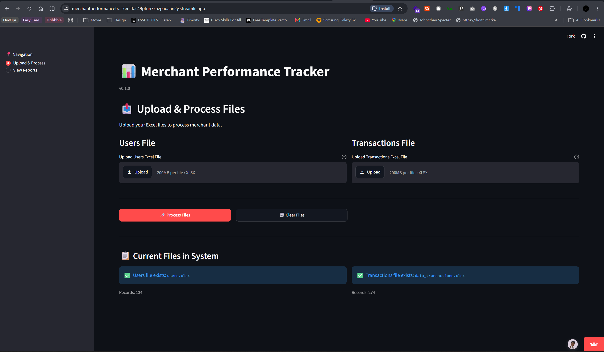

# Web Server Administration: VTU Platform Operations

A case study and runbook from my time administering the production web server for a cloud-based VTU (airtime and data vending) platform at **Olumajek IT Continental**, an official channel partner of MTN Nigeria, Airtel Nigeria and Glo Mobile.

> **Note:** This repository contains no proprietary code, credentials, server addresses or partner API details. The platform was built by a separate development team. This document covers how I **operated and maintained** it after handover.

---

## Overview

| | |
| --- | --- |
| **Role** | Tech Support & IT Project Coordinator |
| **Period** | 2025 – Present |
| **Platform** | Ocayweb, a cloud-based VTU vending platform |
| **Users** | 500+ merchants in the first 12 months. |
| **Integrations** | MTN, Airtel and Glo partner APIs |
| **My responsibility** | Day-to-day server operation, uptime, merchant monitoring, and first-line escalation |

---

## Environment (generic)

```
 Merchants (web / app)
         │
         ▼
 ┌─────────────────┐
 │   Web server    │  ← configuration, SSL, uptime (my area)
 └────────┬────────┘
          │
   ┌──────┴───────┐
   ▼              ▼
 Database     Telecom partner APIs
              (MTN · Airtel · Glo)
```

- **OS:** Linux (Namecheap shared hosting, cPanel)
- **Web server:** Apache-compatible (cPanel)
- **Database:** MySQL
- **Hosting:** Namecheap
- **Monitoring:** Uptimerobot, Custom Scripts

---

## Responsibilities

- Kept the production server running after handover from the development team
- Managed server configuration and settings changes
- Monitored uptime and responded to outages
- Watched the health of telecom partner API connections and escalated failures
- Served as the main technical escalation point for merchant issues (registration problems, failed transactions, bugs)
- Reported recurring defects back to the development team

---

## Routine Operations (Runbook)

### Daily
-  Check uptime dashboard and overnight alerts
-  Review error logs for failed transactions
-  Confirm all three partner APIs (MTN, Airtel, Glo) are responding
-  Clear merchant support tickets escalated overnight

### Weekly
-  Verify database backups completed and can be restored
-  Review disk space, memory and CPU usage
-  Apply approved system updates

### Monthly
-  Check SSL certificate expiry dates
-  Review user and access permissions
-  Summarise uptime and incidents for management

---

## Incident Response

When something breaks, this is the order I work through:

1. **Confirm the problem.** Is it the whole platform, one network (e.g. only MTN), or one merchant?
2. **Check the server.** Is it reachable? Are services running? Is disk or memory full?
3. **Check the logs.** Look for errors around the time the problem started.
4. **Check partner APIs.** If only one network is failing, the issue is usually on the partner side.
5. **Fix or escalate.** Restart services or fix configuration myself; escalate code-level bugs to the developers and partner outages to the telecom contact.
6. **Communicate.** Tell affected merchants what is happening and when it is resolved.
7. **Write it down.** Record the cause and the fix so it is faster next time.

### Example incident

> **A failed transaction with a top omerchant In Ibadan, Oyo State, Nigeria**
>
> **What happened:** Failed trahnsaction was peculiar with a number of Data Plan ID
> **How I found the cause:** Logs showed mismatched PLan ID
> **What I did:** Confirmed with the merchant, to check their configuration settings file.
> **Outcome:** Problem was soolved, because merchant had previosuly lihnked data plan with a wrong Plan ID as supplied by end point.

---

## Results

- Peak day: over 5TB of data bundles vended across the network in 24 hours.
- Resolved over 80% of merchants tickets, within 24 hours of being raised.
- Reduced repeat incident by properly logging issues & solutions workflow.

---

## Skills Demonstrated

 · `Web server configuration` · `Uptime monitoring` · `Incident response` · `API integration support` · `Technical escalation` · `Documentation`

---

## Related Work

- **[Merchant Performance Analytics](https://github.com/yourname/merchant-performance-analytics)**: a reporting tool I built to track merchant performance on the same platform.



---

**Joseph Obaloluwa Adeoye** · Lagos, Nigeria · [josephadeoye30@gmail.com](mailto:josephadeoye30@gmail.com)
